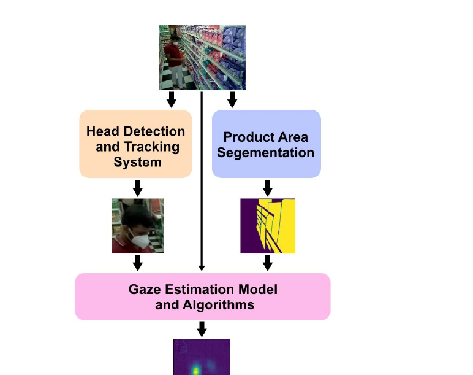
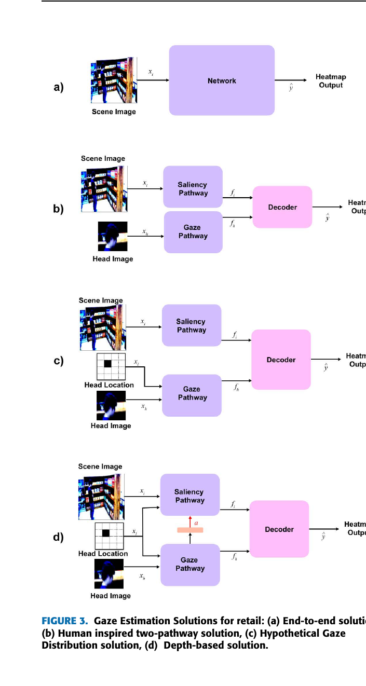
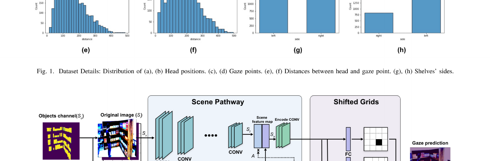
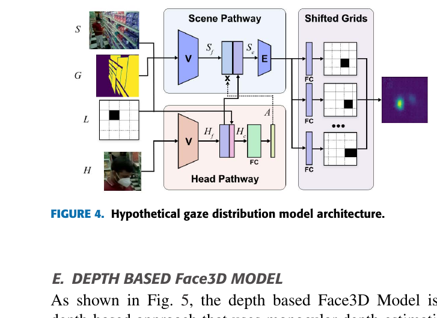
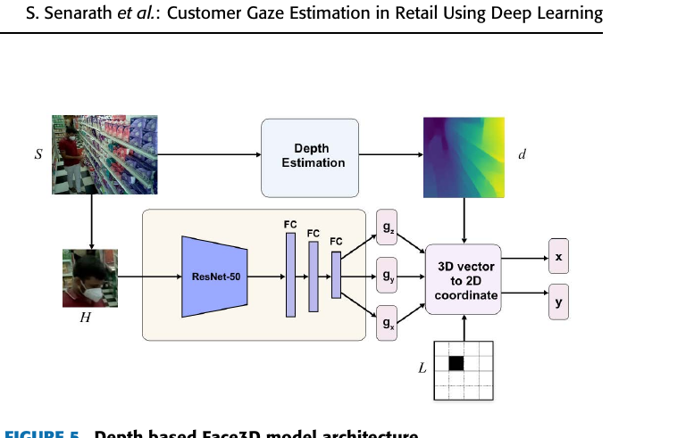
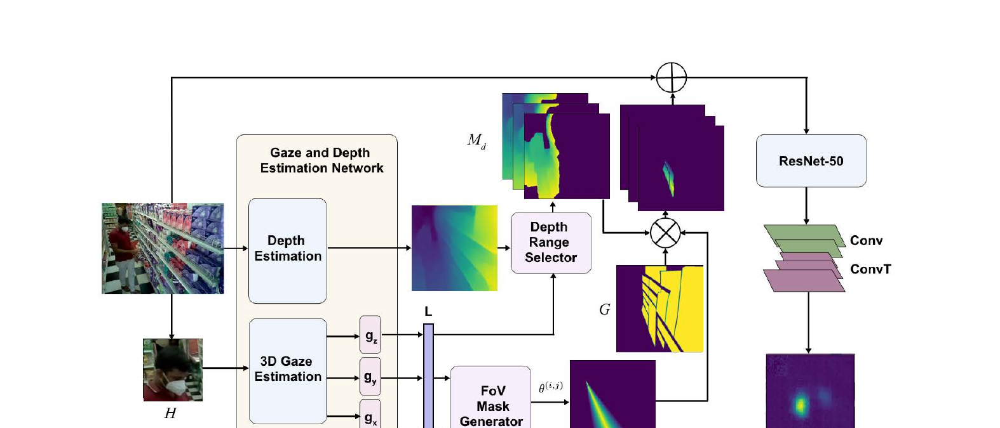

# RetailGaze

**Remote gaze saliency estimation for retail customer behaviour analysis using deep learning.**

This repository contains the deep learning models, dataloaders, and training pipelines developed for two published studies on customer gaze estimation in retail environments. The system predicts where a customer is looking — without requiring any wearable devices, eye-tracking hardware, or personal calibration — using only standard CCTV-style scene images.

---

## Publications

**[1] Customer Gaze Estimation in Retail Using Deep Learning**
Shashimal Senarath, Primesh Pathirana, Dulani Meedeniya, Sampath Jayarathna
*IEEE Access*, Vol. 10, 2022. DOI: [10.1109/ACCESS.2022.3183357](https://doi.org/10.1109/ACCESS.2022.3183357)

**[2] Single-User 2D Gaze Estimation in Retail Environment Using Deep Learning**
Primesh Pathirana, Shashimal Senarath, Dulani Meedeniya, Sampath Jayarathna
*2nd International Conference on Advanced Research in Computing (ICARC)*, 2022. DOI: [10.1109/ICARCS5489.2022.9754167](https://doi.org/10.1109/ICARCS5489.2022.9754167)

The dataset is publicly available on Kaggle: [kaggle.com/dulanim/retailgaze](https://www.kaggle.com/dulanim/retailgaze)

---

## Motivation

Understanding where retail customers direct their gaze is valuable for analysing shopping behaviour, optimising shelf placement, and improving customer experience. Existing approaches either require costly 3D eye tracking hardware, wearable devices, or personal calibration — none of which are practical in a live retail environment.

Remote gaze estimation from back-head images is a scalable, non-intrusive alternative. However, the retail setting introduces specific challenges not addressed by general gaze estimation literature: partial and total head/eye occlusion, varied lighting, significant depth variation across retail shelves, and the need to identify gazed-at product objects rather than merely a 2D gaze point.

---

## System Overview

The full pipeline has three stages:

<p align="center">
  
  <br/>
  <em>Figure 2 (Senarath et al., IEEE Access 2022) — End-to-end system: head detection & tracking → gaze estimation → gaze saliency heatmap → gaze object prediction.</em>
</p>

**Stage 1 — Head Detection & Tracking:** A custom YOLOv5s detector (trained on RetailGaze + GOO) localises the customer's head, and DeepSORT tracks it across frames. The head bounding box crop is passed to the gaze model.

**Stage 2 — Gaze Estimation (DDA):** The Depth-based Dual Attention model predicts a gaze saliency heatmap from the scene image and head crop. See the [model architectures](#model-architectures) below.

**Stage 3 — Gaze Object Prediction:** A rule-based algorithm multiplies the heatmap element-wise with each product segmentation mask and selects the mask with the highest sum as the gazed-at object.

---

## Model Architectures

The codebase implements four model architectures, developed iteratively across both publications.

<p align="center">
  
  <br/>
  <em>Figure 3 (Senarath et al., IEEE Access 2022) — The four design solutions: (a) end-to-end baseline, (b) dual-pathway, (c) + object channel, (d) + depth channel.</em>
</p>

### 1. BaseModel (`models/base.py`)
Baseline: ResNet-50 feature extractor → 2 FC layers → 2D gaze point (x, y). Trained end-to-end on a scene image. Corresponds to design solution (a) above.

### 2. Hypothetical Gaze Distribution — HypoAttention (`models/hypo_attention.py`)
Introduced in publication [2]. Dual-pathway architecture (design solutions b & c):

<p align="center">
  
  <br/>
  <em>Figure 2 (Pathirana et al., ICARC 2022) — Scene pathway + head pathway + shifted grids architecture.</em>
</p>

<p align="center">
  
  <br/>
  <em>Figure 4 (Senarath et al., IEEE Access 2022) — Hypothetical Gaze Distribution model with object channel (G), head location (L), and shifted grids output.</em>
</p>

- **Head pathway** (VGG-16): extracts head feature map; concatenated with the head position channel to compute an attention map over the scene.
- **Scene pathway** (VGG-16): takes the scene image, head position channel, and **object channel** (binary image of product item bounding box boundaries) as a 5-channel input. The attention map from the head pathway is applied to the scene features.
- **Shifted grids classifier**: instead of directly regressing the gaze point, the model predicts five overlapping 5×5 probability grids (shifted in cardinal directions), whose averaged output produces a robust 13×13 fixation heatmap.

The **object channel** is the key retail-specific hand-designed feature: a binary mask where product item boundaries are white and background is black. This narrows the gaze estimation search space to plausible shelf locations.

Best result on GOO-Real: **AUC 0.942, L2-dist 0.143, Angular Error 25.2°** (after GazeFollow + GOO-Real transfer learning).

### 3. Face3D (`models/face3d.py`)
Introduced in publication [1] as the first stage of the DDA model. Introduces **monocular depth** as a novel input modality (design solution d):

<p align="center">
  
  <br/>
  <em>Figure 5 (Senarath et al., IEEE Access 2022) — Face3D: scene → MiDaS depth map (d) + head crop → ResNet-50 → 3D gaze vector (gx, gy, gz) → 2D coordinate.</em>
</p>

- **Depth branch** (MiDaS DPT_Hybrid, frozen): takes the full scene image and produces a normalised depth map.
- **Gaze branch** (ResNet-50): takes the face/head crop and predicts a **3D gaze vector** (gx, gy, gz) rather than a 2D point.
- The depth map is used at training time to construct the z-component of the ground truth label (difference in depth between head location and gaze target location), making the model depth-aware without requiring a depth sensor.

Result on GOO-Real: **AUC 0.94, L2-dist 0.15, Angular Error 20.6°**

### 4. Depth-based Dual Attention — DDA (`Gaze_Dual_Attn/`) [Final Model]
The full three-stage model from publication [1], combining Face3D and HypoAttention:

<p align="center">
  
  <br/>
  <em>Figure 6 (Senarath et al., IEEE Access 2022) — DDA model: Face3D provides 3D gaze (gz, gy, gx) and depth map → FoV Mask Generator + Depth Range Selector → dual attention map (Md ⊗ G) → ResNet-50 heatmap generator.</em>
</p>

| Stage | Component | Function |
|---|---|---|
| 1 | Face3D | Estimates 3D gaze vector + monocular depth map |
| 2 | FoV Mask Generator | Generates a cone-shaped field-of-view mask from 3D gaze direction and head position |
| 2 | Depth Range Selector | Selects three depth sections (2×, 4×, 6× δ) around the estimated gaze depth level |
| 2 | Dual Attention Map | FoV mask ⊗ Depth range mask |
| 2 | HypoAttention + Object Channel | Combines dual attention map with hypothetical gaze distribution |
| 3 | CNN Heatmap Generator | ResNet-50 + ConvTranspose → gaze saliency heatmap |

**Results:**

| Dataset | AUC | L2-dist | Angular Error |
|---|---|---|---|
| GOO-Real | **0.95** | **0.14** | **19.3°** |
| Retail Gaze | **0.95** | **0.15** | **15.3°** |

The DDA model improves angular error by **33%** over the prior best on GOO-Real and **57.9%** on the Retail Gaze dataset, compared to Chong et al. [ECCV 2018].

---

## Datasets

### GOO (Gaze On Objects)
Benchmark dataset for gaze object prediction in retail (mock environment). Contains:
- **GOO-Synth**: 192,000 synthetic images from 50 virtual camera angles, 20 synthetic customer models.
- **GOO-Real**: 9,552 images of 100 subjects (32F / 68M), 24 product categories, 2 camera angles.

Annotations: 2D gaze targets, object bounding boxes, object segmentation masks, head bounding boxes.

### Retail Gaze (Ours)
A novel real-world retail gaze estimation dataset collected in a real supermarket. Key properties:
- **3,922 labelled images**, 2 subjects, **12 different camera angles**
- Shelves contain products from the same category to replicate real retail layout
- Split: 2,745 train / 589 test / 588 validation (70% / 15% / 15%)
- Annotations: 2D gaze target, head bounding box, product area segmentation masks
- Captured under controlled in-store lighting without external light sources
- Images include diverse camera angles to avoid the right-shelf bias present in GOO-Real

Retail Gaze addresses limitations of GOO-Real (only 2 camera angles, mock environment, limited camera diversity).

---

## Setup

**Dependencies:**
```bash
pip install torch torchvision
pip install resnest          # resnest50 backbone
pip install tensorboard tqdm scikit-learn opencv-python scipy Pillow pandas
```

MiDaS is loaded via PyTorch Hub on first use — requires internet access:
```python
torch.hub.load("intel-isl/MiDaS", "DPT_Hybrid")
```

---

## Training & Evaluation

Update the dataset paths in the script to match your local setup, then run:

```bash
# Train / evaluate the Face3D model on Retail Gaze
python test_face3d.py

# Evaluate the base model
python test_base.py

# TensorBoard monitoring
tensorboard --logdir=runs/
```

For the full DDA model and dual-attention baselines, use the notebooks in `Gaze_Dual_Attn/gaze/`:
- `Dual_Attn.ipynb` — DDA model training and evaluation
- `Other_Models.ipynb` — baseline comparisons

Checkpoints are saved by the `EarlyStopping` utility (`early_stopping_pytorch/pytorchtools.py`). Checkpoint keys: `state_dict`, `optimizer`, `epoch`. Learning rate decays by 10× after epoch 15 (configurable via `GazeOptimizer`).

---

## Citation

If you use this code or the Retail Gaze dataset, please cite:

```bibtex
@article{senarath2022customer,
  title   = {Customer Gaze Estimation in Retail Using Deep Learning},
  author  = {Senarath, Shashimal and Pathirana, Primesh and Meedeniya, Dulani and Jayarathna, Sampath},
  journal = {IEEE Access},
  volume  = {10},
  pages   = {64904--64919},
  year    = {2022},
  doi     = {10.1109/ACCESS.2022.3183357}
}

@inproceedings{pathirana2022single,
  title     = {Single-User 2D Gaze Estimation in Retail Environment Using Deep Learning},
  author    = {Pathirana, Primesh and Senarath, Shashimal and Meedeniya, Dulani and Jayarathna, Sampath},
  booktitle = {2nd International Conference on Advanced Research in Computing (ICARC)},
  pages     = {206--211},
  year      = {2022},
  doi       = {10.1109/ICARCS5489.2022.9754167}
}
```

---

## Acknowledgements

This work was supported in part by the National Science Foundation CAREER under Grant 2045523, and in part by the Department of Computer Science, Old Dominion University, Norfolk, Virginia, USA.
